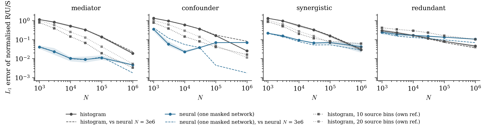

# SURD: Synergistic-Unique-Redundant Decomposition of causality

[](https://github.com/ALD-Lab/SURD/actions/workflows/tests.yml)
[](https://pypi.org/project/surd/)
[](LICENSE)
[](https://doi.org/10.1038/s41467-024-53373-4)
[](https://doi.org/10.5281/zenodo.13647182)

SURD is a method for causal inference in time series. It measures the information that past observations of a set of variables carry about the future of a target variable and splits it into redundant, unique and synergistic contributions. The method also quantifies the causality leak, the part of the future of the target that the observed variables cannot explain. SURD needs only pairs of past and future events, so it applies to simulations and experiments alike. It handles several variables, dependencies at different time lags and instantaneous links. The method is described in Martínez-Sánchez, Arranz & Lozano-Durán, *Nature Communications* 15, 9296 (2024). The subpackage `surd.states` resolves the same decomposition over the states of the variables, following Martínez-Sánchez & Lozano-Durán, *Communications Physics* 9, 15 (2025). See [Causality by states](#causality-by-states).


## Installation

From PyPI:
```sh
pip install surd
```

From a clone of this repository:
```sh
git clone https://github.com/ALD-Lab/SURD.git
cd SURD
pip install .
```

With conda, the environment file installs the dependencies and the package:
```sh
conda env create -f environment.yml
conda activate surd
```

SURD depends on NumPy, SciPy, Matplotlib and tqdm and runs on Python 3.9 or newer, on Linux, macOS and Windows. The optional extras are:

- `pip install "surd[parallel]"` adds `pymp-pypi`, which runs the loop over target variables of `surd.run_parallel` in parallel (Linux and macOS). Without it the targets run one after another with the same result. Example E03 of `surd.states` uses it too.
- `pip install "surd[transport]"` adds `mpart` for density estimation with transport maps (example E07). On `osx-arm64` use `pip install mpart`, since the conda package does not exist for that platform. See the [MParT documentation](https://measuretransport.github.io/MParT/).
- `pip install "surd[neural]"` adds PyTorch for `surd.neural`, the neural estimate of the specific mutual information. For a CPU-only build of PyTorch, install it first from [pytorch.org](https://pytorch.org).
- `pip install "surd[states]"` adds scikit-image and scikit-learn for the isosurfaces of `states.plot_states_3d` and the density estimate of `states.it_tools.hist_knn`. The decomposition by states needs neither.
- `pip install "surd[examples]"` adds JupyterLab and marimo to run the notebooks.
- `pip install "surd[docs]"` adds Sphinx to build the documentation in `docs/`.

The cost of SURD grows with the number of variables and bins, since it estimates joint probability distributions. The examples run on a laptop with 16 GB of RAM.

## Quick start

Two independent bits and a target equal to their XOR one step later. Each bit alone says nothing about the target, so the information is synergistic.

```python
import numpy as np
import surd

rng = np.random.default_rng(0)
q1, q2 = rng.integers(0, 2, size=(2, 200_000))    # two independent bits in time
target = np.roll(q1 ^ q2, 1)                      # their XOR, one step later
Y = np.vstack([target[1:], q1[:-1], q2[:-1]])     # future of the target first, sources after
hist, _ = np.histogramdd(Y.T, bins=2)
I_R, I_S, MI, info_leak = surd.surd(hist)
surd.nice_print(I_R, I_S, MI, info_leak)
```

```
    Redundant (R):
        (1, 2)      : 0.0000
    Unique (U):
        (1,)        : 0.0000
        (2,)        : 0.0000
    Synergystic (S):
        (1, 2)      : 1.0000
    Information Leak:  0.00%
```

## How to use the method

The input is a histogram of the joint distribution of the future of the target and the present of the sources. Axis 0 is the target and axes 1 to N are the sources. The outputs are dictionaries keyed by tuples of source indices, counted from 1.

| Function | What it does |
|---|---|
| `surd.surd(p)` | Decomposition of the histogram `p`. Returns `I_R` (redundant terms, with the unique terms under the one-element keys), `I_S` (synergistic terms), `MI` (mutual information of each subset of sources with the target) and `info_leak`, the causality leak in [0, 1]. |
| `surd.surd_hd(Y, nbins, max_combs)` | Same decomposition from the signals `Y` (target first) for systems with many variables. Synergies are computed up to `max_combs` sources at a time. Returns `I_R`, `I_S` and `MI`. |
| `surd.run(X, nvars, nlag, nbins, axs)` | Runs `surd.surd` with each of the `nvars` signals of `X` as target at lag `nlag`, prints and plots the result. |
| `surd.run_parallel(...)` | Same as `surd.run`, with the targets in parallel when `pymp` is available. |
| `surd.run_multiple_lags(X, nvars, nlag, nbins, max_combs, axs)` | Same as `surd.run` with all lags from 1 to `nlag` as sources. |
| `surd.assign(Is, p_t)` | Second half of `surd.surd`: assigns the specific mutual information `Is` to redundant, unique and synergistic terms. Use it to feed an estimate of the specific mutual information other than the histogram. |
| `surd.nice_print(I_R, I_S, MI, info_leak)` | Prints the terms normalized by the mutual information of the full set of sources and the leak in percent. |
| `surd.plot(I_R, I_S, info_leak, axs, nvars, threshold)` | Bar chart of the normalized terms (blue redundant, red unique, orange synergistic) and a separate bar for the leak. |

`surd.it_tools` has the entropies, conditional entropies, mutual information and transfer entropy used by the method. `surd.analytic_eqs` has the benchmark systems of the paper. `surd.transport_map` estimates densities with transport maps and needs `mpart`.

Scripts written for the previous layout, which added `utils/` to `sys.path` and imported `surd`, `it_tools`, `analytic_eqs` and `transport_map` as top-level modules, keep working. The files in `utils/` load the package.

## Short records and many sources

The histogram of `surd.surd` has `nbins**(nvars + 1)` cells and needs many more samples than cells. With three sources and 50 bins that is 6.25 million cells. `surd.neural` estimates the same specific mutual information with a classifier instead. The target is binned as before, the sources stay continuous, and one network predicts the target bin from every subset of sources. Each sample is scored by a network trained on the other samples. The terms are assigned by the same rule as in `surd.surd`.

```python
import numpy as np
import surd
import surd.neural
from surd import analytic_eqs

q1, q2, q3 = analytic_eqs.mediator(10_000)          # Q3 -> Q2 -> Q1
X = np.array([q1, q2, q3])[:, 1000:]                # drop the transient
Y = np.vstack([X[0, 1:], X[:, :-1]])                # future of Q1 first, then Q1, Q2, Q3

I_R, I_S, MI, info_leak = surd.neural.surd(Y, nbins=50)
surd.nice_print(I_R, I_S, MI, info_leak)
```

With these 9,000 samples the neural estimate gives 0.99 of the information to Q2, which is the correct answer. The histogram gives 0.73 to Q2 and 0.19 to a synergy of the three sources that does not exist.

The figure compares both estimates on the four systems of example E02 as a function of the number of samples N. The error is the L1 distance of the normalized terms to a reference histogram with N = 10<sup>7</sup>.



| | Histogram (`surd.surd`) | Neural (`surd.neural.surd`) |
|---|---|---|
| Mediator, confounder, synergistic collider | Error 0.5 to 0.6 at N = 10<sup>4</sup>, 0.02 to 0.03 at N = 10<sup>6</sup> | Error 0.01 to 0.09 at N = 10<sup>4</sup> |
| Redundant collider | Same error up to N = 10<sup>4</sup>, better above | No gain |
| Logic gates, few discrete states | Better at every N | Error floor of 0.01 to 0.03 |
| Five or six sources, N = 10<sup>4</sup> | Unusable (error 0.7 to 1.1 with 8 to 15 bins) | Error 0.03 to 0.11 |
| Bias on a shuffled target | Up to several bits at N = 10<sup>3</sup> | Below 0.1 bits, check with `surd.neural.null_mi` |
| Cost on one CPU thread | Under a second | 15 s at N = 10<sup>3</sup>, 2 min at N = 10<sup>6</sup> |

Use the histogram when it is well sampled, and the neural estimate when `nbins**(nvars + 1)` is much larger than the number of samples. At large N the two converge to slightly different values. The histogram bins the sources and the neural estimate does not, and the binned answer still moves with the number of bins at 70 bins. `surd.neural.null_mi` shuffles the target against the sources and returns the mutual information the estimate finds where there is none. Compare it with `max(MI.values())`. The training options are in `surd.neural.DEFAULTS`, and `device="cuda"` runs the training on a GPU.

## Examples

The notebooks in [`examples/`](examples) reproduce the cases of the paper. Run them from the `examples` folder. They import the installed package and fall back to `../src` from a plain clone.

| Notebook | What it shows |
|---|---|
| [E01](examples/E01_logic_gates.ipynb) | Logic gates. A duplicated source is redundant, a copied source is unique, an XOR is synergistic. |
| [E02](examples/E02_building_blocks.ipynb) | Building blocks of causal interactions: mediator, confounder, synergistic collider and redundant collider. |
| [E03](examples/E03_energy_cascade.ipynb) | Energy cascade in isotropic turbulence. Causality between the energy transfer at four scales from a direct numerical simulation. |
| [E04](examples/E04_lagged_dependencies.ipynb) | Stochastic systems with dependencies at several time lags, linear and nonlinear. |
| [E05](examples/E05_Moran_effect.ipynb) | Moran effect. Two populations driven by a common environmental forcing that is not observed. |
| [E06](examples/E06_logistic_system.ipynb) | Coupled logistic maps with one-way and two-way coupling. |
| [E07](examples/E07_transport_map.ipynb) | Density estimation with transport maps instead of histograms (needs `mpart`). |
| [E08](examples/E08_eight_species.ipynb) | System with eight interacting species. Decomposition with synergies truncated at a given order. |
| [E09](examples/E09_contemporaneous.ipynb) | Systems with contemporaneous links on top of mediator, confounder and synergistic interactions. |
| [E10](examples/E10_inner_outer.ipynb) | Experimental data from a turbulent boundary layer. Causality between inner-layer and outer-layer velocity motions as a function of the time lag. |

The data for E03 and E10 are in [`data/`](data). E02 writes the signals it generates to `data/` on the first run.

## Causality by states

SURD says which variables are causal. `surd.states` says in which states they are. The method quantifies causality as the information gained about the future states of the target, resolved over the states of the sources and of the target, and splits it into redundant, unique and synergistic contributions as above. A state of a source is causal for a future state of the target when knowing it makes that future state more likely, and non-causal when it makes it less likely. The formulation needs only pairs of past and future events, so it applies to simulations and experiments alike. It handles several variables, dependencies at different time lags and instantaneous links, and it reports the causality that unobserved variables leave unexplained. The method is described in Martínez-Sánchez & Lozano-Durán, *Communications Physics* 9, 15 (2025).


A source that acts only when it is positive. `Un[(1,)][t, s]` is the unique causality from state `s` of the source to state `t` of the target, so the rows of positive `q1` carry it.

```python
import numpy as np
from surd import states

rng = np.random.default_rng(0)
q1, q3 = rng.standard_normal((2, 1_000_000))                                  # two sources
q2 = np.where(q1 > 0, np.sin(q1), 0.0) + 0.1 * rng.standard_normal(q1.size)  # future target: q1 acts only when positive
hist, edges = np.histogramdd(np.vstack([q2, q1, q3]).T, bins=25)              # target first, sources after
I_R, I_S, MI, leak, Rd, Un, Sy = states.surd_states(hist)                     # Rd, Un, Sy: one array per term, indexed by states
states.nice_print(I_R, I_S, MI, leak)
```

```
    Redundant (R):
        (1, 2)      : 0.0002
    Unique (U):
        (1,)        : 0.9982
        (2,)        : 0.0000
    Synergystic (S):
        (1, 2)      : 0.0016
    Information Leak: 63.40%
```

| Function | What it does |
|---|---|
| `states.surd_states(p)` | Decomposition of the histogram `p` (target on axis 0). Returns `I_R`, `I_S`, `MI` and `info_leak` as `surd.surd`, plus `Rd_states`, `Un_states` and `Sy_states`: for each pair of sources (or each source for `Un_states`) an array with the contribution of every combination of target and source states. Unlike `surd.surd`, no regularization is added to `p`. |
| `states.run(X, nvars, nlag, nbins, axs)` | Runs `states.surd_states` with each signal of `X` as target at lag `nlag`, prints and plots the result. |
| `states.plot`, `states.nice_print` | Same as their `surd` counterparts. |
| `states.plot_states(data, bins, target, source, save_path, ...)` | Map of a state-resolved term over the states of one source and the target, with the marginal sums on top and right. |
| `states.plot_states_3d(data, bins, title, level)` | Isosurface of a state-resolved term over the target and two sources (needs scikit-image). |
| `states.datasets.load_inner_outer(n_samples)` | Boundary layer record of example E03 (two signals, 19,990,000 samples, 148 MB). Downloaded once into `~/.cache/surd`, or into `$SURD_DATA`, and checked against its SHA-256. |

`states.it_tools` and `states.analytic_eqs` are the versions that ship with the paper and differ from `surd.it_tools` and `surd.analytic_eqs`: no regularization of the histogram, and the benchmark systems `source` and `target` instead of the mediator and collider cases.

The notebooks in [`examples/states/`](examples/states) reproduce the cases of the paper. Run them from that folder. The [`marimo/`](examples/states/marimo) subfolder has the same examples as marimo notebooks, which also run as plain Python scripts.

| Notebook | What it shows |
|---|---|
| [E01](examples/states/E01_benchmark_source.ipynb) | Benchmark system where the causality of the sources depends on the state of the first one. Redundant, unique and synergistic maps by states, in two and three dimensions. |
| [E02](examples/states/E02_benchmark_target.ipynb) | Benchmark system where the causality depends on the state of the target. |
| [E03](examples/states/E03_inner_outer.ipynb) | Experimental data from a turbulent boundary layer. Unique causality from the outer to the inner layer as a function of the time lag, and the decomposition by states at the lag of maximum cross-induced causality. Needs `pymp` and downloads the data on first run. |

E01 and E02 generate their signals and store them in `examples/states/data/` on the first run. E01 and E02 need scikit-image for the 3-D maps.

## Citation

If you use SURD in your research or software, please cite the paper:

```bibtex
@article{surd,
author={Mart{\'\i}nez-S{\'a}nchez, {\'A}lvaro and Arranz, Gonzalo and Lozano-Dur{\'a}n, Adri{\'a}n},
title={Decomposing causality into its synergistic, unique, and redundant components},
journal={Nature Communications},
year={2024},
month={Nov},
day={01},
volume={15},
number={1},
pages={9296},
issn={2041-1723},
doi={10.1038/s41467-024-53373-4}
}
```

If you use `surd.states`, please also cite:

```bibtex
@article{surd-states,
  author  = {Mart{\'i}nez-S{\'a}nchez, {\'A}lvaro and Lozano-Dur{\'a}n, Adri{\'a}n},
  title   = {Observational causality by states and interaction type for scientific discovery},
  journal = {Communications Physics},
  year    = {2025},
  month   = {Dec},
  day     = {16},
  volume  = {9},
  number  = {1},
  pages   = {15},
  issn    = {2399-3650},
  doi     = {10.1038/s42005-025-02447-w}
}
```

The file [`CITATION.cff`](CITATION.cff) carries both references in machine-readable form.

## Acknowledgements

Enrico Foglia packaged and documented the SURD-states code that became `surd.states`.

## License

This project is licensed under the MIT License. See [LICENSE](LICENSE).
